<!-- Every graphic on this page is an SVG that the scripts in this repo draw. See scripts/. -->

<a href="https://github.com/jrob99/jrob99"><picture><source media="(prefers-color-scheme: dark)" srcset="https://raw.githubusercontent.com/jrob99/jrob99/main/assets/hero-dark.svg"></picture></a>

<a href="https://github.com/topics/prediction-market"><picture><source media="(prefers-color-scheme: dark)" srcset="https://raw.githubusercontent.com/jrob99/jrob99/main/assets/card-markets-dark.svg"></picture></a>
<a href="https://github.com/topics/crypto"><picture><source media="(prefers-color-scheme: dark)" srcset="https://raw.githubusercontent.com/jrob99/jrob99/main/assets/card-crypto-dark.svg"></picture></a>
<a href="https://github.com/jrob99/jrob99/tree/main/scripts"><picture><source media="(prefers-color-scheme: dark)" srcset="https://raw.githubusercontent.com/jrob99/jrob99/main/assets/card-coding-dark.svg"></picture></a>
<a href="https://github.com/topics/gaming"><picture><source media="(prefers-color-scheme: dark)" srcset="https://raw.githubusercontent.com/jrob99/jrob99/main/assets/card-gaming-dark.svg"></picture></a>

<a href="https://github.com/jrob99/jrob99/blob/main/scripts/build-pulse.mjs"><picture><source media="(prefers-color-scheme: dark)" srcset="https://raw.githubusercontent.com/jrob99/jrob99/output/pulse-markets-dark.svg"></picture></a>
<a href="https://github.com/jrob99/jrob99/blob/main/scripts/build-pulse.mjs"><picture><source media="(prefers-color-scheme: dark)" srcset="https://raw.githubusercontent.com/jrob99/jrob99/output/pulse-crypto-dark.svg"></picture></a>

<picture><source media="(prefers-color-scheme: dark)" srcset="https://skillicons.dev/icons?i=ts,js,python,react,nextjs,nodejs,tailwind,postgres,supabase,vercel,githubactions&amp;theme=dark"></picture>

<a href="https://github.com/Platane/snk"><picture><source media="(prefers-color-scheme: dark)" srcset="https://raw.githubusercontent.com/jrob99/jrob99/output/snake-dark.svg"></picture></a>

<a href="https://github.com/jrob99/jrob99"><picture><source media="(prefers-color-scheme: dark)" srcset="https://raw.githubusercontent.com/jrob99/jrob99/main/assets/footer-dark.svg"></picture></a>

Drawn by <a href="https://github.com/jrob99/jrob99/tree/main/scripts">code in this repo</a> and refreshed hourly by GitHub Actions. Odds: <a href="https://polymarket.com">Polymarket</a>. Prices: <a href="https://www.coinbase.com">Coinbase</a>. Snake: <a href="https://github.com/Platane/snk">Platane/snk</a>. Icons: <a href="https://skillicons.dev">Skill Icons</a>. Not financial advice.

